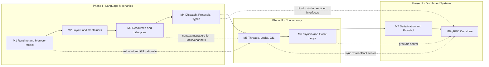

# Deliverable 3 — Syllabus Architecture (Overview)

## Audience Contract

| Assumed (skip entirely) | Not assumed (teach from first principles) |
|:---|:---|
| Control flow, functions, recursion, primitive types | Threads, shared-state synchronization, memory visibility |
| Pointers, stack vs heap, manual layout, alignment | Event loops, cooperative scheduling |
| RAII, move semantics, smart pointers | Wire-format design, schema evolution |
| Compilation/linking model, ABI | RPC semantics: deadlines, status codes, streaming flow control |
| OOP, virtual dispatch, templates | — |

**Terminal objective:** design, implement, test, and operate a production-grade, concurrent gRPC microservice in Python 3.12+ whose correctness does not depend on the GIL.

## Progression Map

## Module Index

| # | Module | Core question | Exemplar lab (Stage 1) | Est. hours |
|:---|:---|:---|:---|:---|
| 1 | [CPython Runtime & Memory Model](./module_01_runtime_memory.md) | What *is* a Python variable, and who frees it? | `M1-L01` ownership cycles ✅ | 8 |
| 2 | [Memory Layout & Core Containers](./module_02_layout_containers.md) | Where are the bytes, and what does each access cost? | `M2-L01` slots footprint ✅ | 8 |
| 3 | [Resource Management & Lifecycles](./module_03_resources_lifecycles.md) | How do I get RAII guarantees without destructors? | — | 6 |
| 4 | [Dispatch, Protocols & Type Systems](./module_04_dispatch_types.md) | How do vtables and concepts map to duck typing + static checking? | — | 8 |
| 5 | [Concurrency Fundamentals & Threading](./module_05_concurrency_threading.md) | What is a race, how do I prevent it, and what does the GIL really do? | `M5-L01` single-flight cache ✅ | 14 |
| 6 | [Async I/O & Event-Driven Architecture](./module_06_asyncio.md) | How does one thread serve 10k connections? | — | 10 |
| 7 | [Serialization & Protocol Buffers](./module_07_protobuf.md) | What goes on the wire, and how do schemas evolve safely? | — | 6 |
| 8 | [Capstone: gRPC Microservice](./module_08_grpc_capstone.md) | How do I build, test, and operate a concurrent RPC service? | — | 16 |

✅ = runnable exemplar shipped in `labs/` to validate the harness design.

## Module Template

Every module document follows this fixed structure:

1. **Learning outcomes** — measurable, verb-first.
2. **(a) Core Mental Model** — the single translation the learner must internalize, stated as C++ → Python.
3. **(b) Systems Deep-Dive** — CPython internals, OS mechanics, source files to read.
4. **(c) Key Idioms & Gotchas** — a two-column idiom/anti-idiom table + linked false equivalences (FE-n).
5. **(d) Interactive Lab Specification** — lab table (ID, C++ anchor, naive anti-pattern, refactor criteria, probes).
6. **Exit criteria** — what must be green before advancing.

## Toolchain

| Tool | Purpose | First used |
|:---|:---|:---|
| CPython 3.12+ (3.13 recommended), optional `python3.14t` | Runtime; free-threaded build for M5 verification | M1 |
| `pytest` | Lab verification harness | M1 |
| `hypothesis` | Property-based tests (int semantics, codecs) | M2 |
| `mypy --strict` / `pyright` | Static type verification | M4 |
| `ruff` | Lint (catches FE-2, FE-6, FE-9 statically) | M1 |
| `pytest-asyncio` | Async test functions | M6 |
| `protobuf`, `grpcio`, `grpcio-tools` | Serialization, RPC, codegen | M7 |
| `grpcio-health-checking`, `grpcio-reflection` | Operability | M8 |
| `py-spy` (optional) | Sampling profiler; shows GIL contention (`--gil`) | M5 |

## Assessment Model

- **Per lab:** all criteria green on `solution.py` (`./lab.py test <ID>`).
- **Per module:** exit criteria + a written "translation note" (≤300 words) explaining one trap in C++ terms.
- **Capstone gate:** full integration suite passes on both the sync and `grpc.aio` server, under the concurrency stress profile, with p99 latency within budget.
