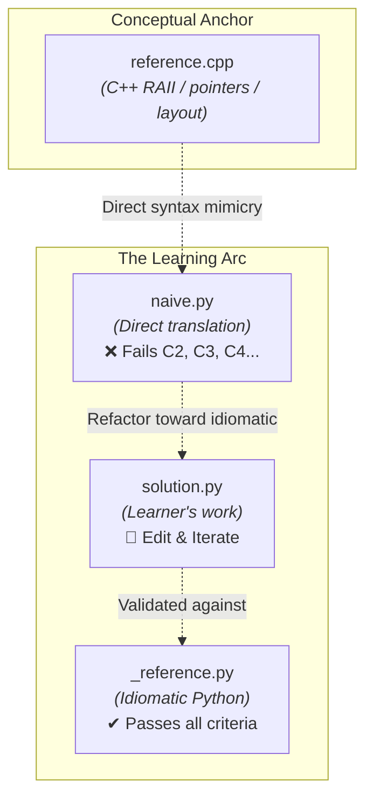

# Deliverable 4 — Interactive Lab Harness Specification

> **Architectural Inspiration.** In `hermes-pantheon-pb/sql-ra-lab`, learning relational algebra
> and query optimization relies on a dual-representation paradigm: every SQL query is analyzed
> side-by-side with its relational algebra AST ($\sigma, \pi, \bowtie$), and execution is validated
> against real, in-memory databases with automatic discrepancy reporting.
>
> In `cpp2py-systems-lab`, we adapt this principle to **systems programming**:
> 1. **Conceptual Triptych:** Every exercise presents a 3-way side-by-side mapping:
>    `C++ Conceptual Idiom` ➔ `Naive C-Style Python Anti-Pattern` ➔ `Idiomatic Python 3.12+`.
> 2. **Property-Driven Verification:** Rather than testing superficial output strings, the test
>    harness instruments the runtime engine to measure refcounts, memory footprints, lock
>    contention, thread interleavings, and latency percentiles.

---

## 1. The Lab Triptych Architecture

Every lab is isolated in its own directory under `labs/<lab_id_slug>/` and contains three
parallel implementations of the same problem:

```text
labs/m1_l01_ownership_cycles/
├── lab.toml          # Lab manifest: metadata, runtime constraints, criteria
├── problem.md        # Pedagogical guide, C++ comparison, failure diagnostics
├── reference.cpp     # C++ reference implementation (mental anchor)
├── naive.py          # Naive 1:1 translation (broken anti-pattern; MUST fail tests)
├── solution.py       # Learner workspace (initially a copy of naive.py)
├── _reference.py     # Idiomatic, production-grade Python solution (hidden reference)
└── test_lab.py       # Test harness parameterized over the target implementation
```

### The 3 Targets Explained



1. **`reference.cpp` (The Mental Anchor):**
   Clean modern C++ (C++20). Demonstrates how a systems programmer naturally models the problem
   using manual layout, deterministic destruction, smart pointers, or mutex locks.
2. **`naive.py` (The Trap):**
   What happens when a C++ engineer translates the C++ syntax into Python line-by-line without
   accounting for Python's object model. It passes basic API correctness (C1), but catastrophically
   violates systems properties (leaks memory in cycles, exhibits data races, or hoards the GIL).
3. **`solution.py` (The Workspace):**
   The student's active workspace. By running `./lab.py test <LAB_ID>`, the student sees their current
   scorecard and iteratively refactors until all criteria turn green.
4. **`_reference.py` (The Oracle):**
   The reference implementation written using modern Python 3.12+ primitives (`__slots__`,
   `weakref`, `contextlib`, `asyncio.TaskGroup`, `threading.Barrier`, etc.). Used by the harness
   to prove that the test suite is 100% satisfiable.

---

## 2. Lab Manifest Schema (`lab.toml`)

Every lab includes a `lab.toml` file defining its metadata and validation criteria:

```toml
id = "M1-L01"
module = 1
title = "Ownership Cycles: Tree with Parent Links"
difficulty = 2                 # 1 (introductory) to 5 (capstone-grade)
time_budget_min = 40
concepts = ["reference counting", "cyclic GC", "weakref", "ownership translation"]
false_equivalences = ["FE-3"]

[triptych]
cpp = "reference.cpp"
naive = "naive.py"
idiomatic = "_reference.py"

[runtime]
python = ">=3.12"
requires = []                  # Optional extra dependencies: ["hypothesis", "grpcio"]
free_threading = "must-pass"   # "must-pass" | "may-skip" | "n/a"
stress_repeats = 1             # Number of repetitions under --repeat stress mode

[[criteria]]
id = "C1"
kind = "correctness"
description = "add_child / parent / children / path() behave like the C++ API"
naive_must_fail = false

[[criteria]]
id = "C2"
kind = "lifetime"
description = "Dropping the root frees every node with the cyclic GC disabled"
naive_must_fail = true

[[criteria]]
id = "C3"
kind = "ownership"
description = "add_child() adds zero strong references to the parent"
naive_must_fail = true
```

### Criteria Classification

Each criterion has a `kind` that reflects its systems dimension:
- `correctness`: Functional behavior, return values, API parity with C++.
- `lifetime`: Refcount deallocation, deterministic cleanup, cycle prevention.
- `ownership`: Reference counts, alias isolation, weak-reference semantics.
- `memory`: Memory footprint per instance, heap retention under `tracemalloc`.
- `concurrency`: Freedom from race conditions, atomic operations, deadlock avoidance.
- `latency`: p95/p99 execution time under load, scheduling overhead.
- `safety`: Handling of missing resources, dangling pointers, exception chaining.

---

## 3. The Runtime Probes Library (`harness.probes`)

To avoid flaky testing and provide meaningful systems feedback, the harness provides a dedicated
suite of runtime probes. These serve as the Python equivalent of Valgrind, Heaptrack, and TSan:

### 3.1 Memory & Lifetime Probes

#### `gc_disabled()`
A context manager that disables CPython's generational cyclic garbage collector:
```python
with gc_disabled():
    root, refs = build_tree(impl.Node)
    del root
    # If any node survives, it is kept alive by a reference cycle,
    # proving that deterministic deallocation has failed.
    assert sum(r() is not None for r in refs) == 0
```
*Why this matters:* In production systems (e.g., real-time streaming, high-frequency services),
unintentional cyclic references force the cyclic GC to run, triggering latency spikes and
fragmenting heap memory.

#### `refcount_delta(obj, action)`
Measures how many *persistent strong references* are added to `obj` during `action()`:
```python
parent = impl.Node("p")
# Verifies that child -> parent link does not increase parent's ob_refcnt:
delta = refcount_delta(parent, lambda: parent.add_child(impl.Node("c")))
assert delta == 0
```

#### `measure_alloc(fn) -> tuple[T, AllocReport]`
Wraps `fn` with `tracemalloc` to record both the net retained bytes and peak allocation:
```python
_, report = measure_alloc(lambda: [impl.Tick(ts, px, qty) for _ in range(100_000)])
bytes_per_instance = report.net_bytes / 100_000
assert bytes_per_instance <= 64.0  # Asserts __slots__ optimization
```

### 3.2 Concurrency & Stress Probes

#### `aggressive_switching(interval=1e-6)`
Temporarily sets `sys.setswitchinterval(1e-6)`. In standard CPython, the GIL switch interval is
5 milliseconds (roughly hundreds of bytecodes). Setting this to 1 microsecond forces the GIL
eval-breaker to trigger between almost every bytecode instruction, exposing race conditions
instantly without needing hours of testing.

#### `run_concurrently(fn, n_threads, timeout=10.0) -> ConcurrentRun`
Synchronizes `n_threads` at a `threading.Barrier` before releasing them simultaneously.
- Detects check-then-act races and thundering herds.
- Catches deadlocks via a timeout watchdog and formats the live stack frames of all stuck threads.

#### `measure_latency(fn, n=1000, warmup=50) -> LatencyStats`
Performs warm-up iterations (to allow PEP 659 specializing adaptive interpreter quickening),
records high-resolution `time.perf_counter` timestamps, and calculates `p50`, `p95`, `p99`, and `max`.

---

## 4. Test Target Selection & The Criteria Scorecard

Tests are written using standard `pytest`, but import their target class dynamically through the
`impl` fixture provided by `harness.pytest_plugin`:

```python
import pytest
from types import ModuleType

@pytest.mark.criterion("C2")
def test_deterministic_destruction(impl: ModuleType) -> None:
    # `impl` dynamically resolves to `naive.py`, `solution.py`, or `_reference.py`
    res = impl.Resource()
    ...
```

### Terminal Output: The Verification Scorecard
When tests run, the plugin aggregates test results by criterion ID and renders a visual scorecard:

```text
━━━━━━━━━━━━━━━━━━━━━━━━━━━━━━ criteria scorecard ━━━━━━━━━━━━━━━━━━━━━━━━━━━━━━
M1-L01 · Ownership Cycles: Tree with Parent Links   [target=solution]
  ✔ C1   correctness  add_child / parent / children / path() behave like the C++ API  2/2
  ✔ C2   lifetime     Dropping the root frees every node with the cyclic GC disabled  1/1
  ✔ C3   ownership    add_child() adds zero strong references to the parent  1/1
  ✔ C4   memory       Build-and-drop of a 1,000-node tree retains < 16 KiB (GC disabled)  1/1
  ✔ C5   safety       A child that outlives its parent reports parent == None  1/1
============================== 6 passed in 0.08s ===============================
```

If testing `naive`, criteria marked `naive_must_fail = true` will show a red `✘`, validating
that the test suite accurately detects the anti-pattern.

---

## 5. The Unified CLI (`lab.py`)

Similar to `db_lab.py` in `sql-ra-lab`, a centralized CLI provides a unified developer experience:

```bash
# List all 8 modules and available labs with completion status
./lab.py list

# Inspect a lab: problem description, C++ anchor, and criteria
./lab.py show M1-L01

# Run tests against your solution (default)
./lab.py test M1-L01

# Run tests against naive or reference
./lab.py test M1-L01 --target naive
./lab.py test M1-L01 --target reference

# Side-by-side or unified diff between naive and your solution
./lab.py diff M1-L01

# Meta-verification: verifies reference passes 100% AND naive fails all expected criteria
./lab.py verify M1-L01

# Reset solution.py back to naive.py
./lab.py reset M1-L01
```

---

## 6. Stage 2 Exercise Authoring Guide

When implementing new labs for Modules 1 through 8, authors follow this 5-step protocol:

1. **Scaffold:** Run `./lab.py create <LAB_ID> <slug>` (or copy `labs/_template`).
2. **Define C++ Mental Model:** Write `reference.cpp`. Keep it concise (< 60 lines), focusing
   strictly on the idiomatic C++ way to represent the concept.
3. **Write the Anti-Pattern:** Write `naive.py`. Emulate a C++ programmer writing literal Python.
4. **Author the Reference:** Write `_reference.py` using idiomatic Python 3.12+ features.
5. **Formulate Verification Criteria & Tests:**
   - Define criteria in `lab.toml` (with at least 2 criteria marked `naive_must_fail = true`).
   - Write `test_lab.py` tagging each test with `@pytest.mark.criterion("Cn")`.
   - Run `./lab.py verify <LAB_ID>` to mathematically ensure the lab passes the invariant:
     $$\text{Score}(\text{Reference}) = 1.0 \quad \land \quad \text{Failed}(\text{Naive}) \supseteq \{ c \in \text{Criteria} \mid c.\text{naive\_must\_fail} = \text{true} \}$$
